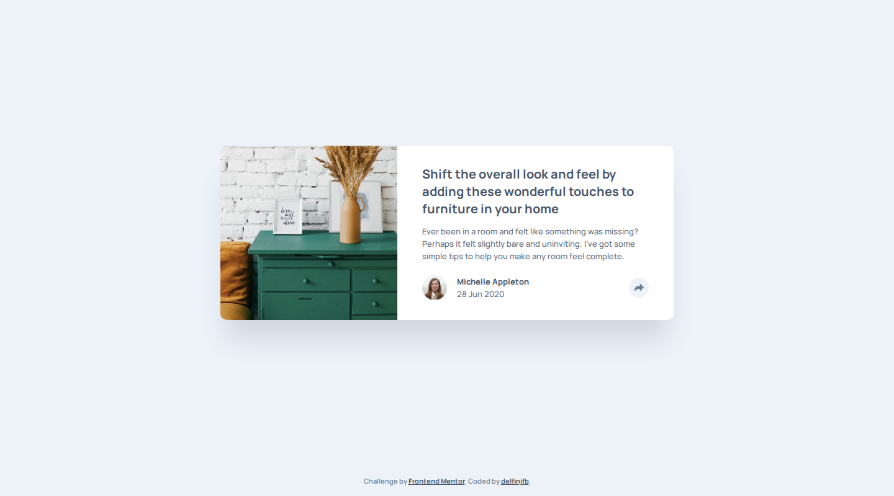
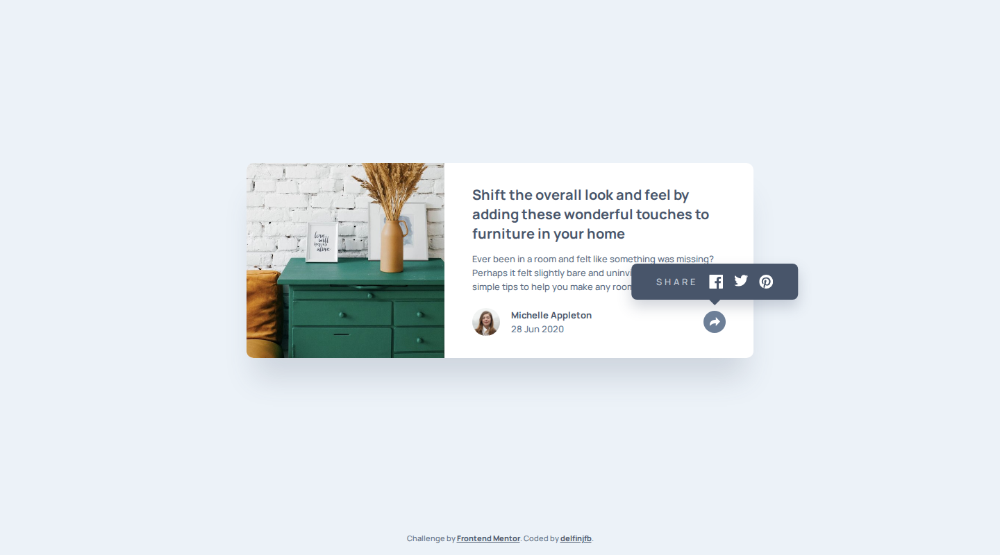
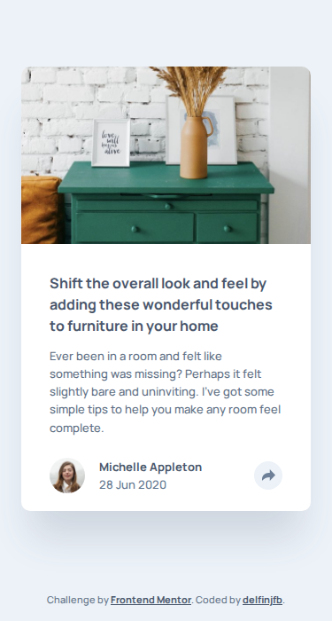
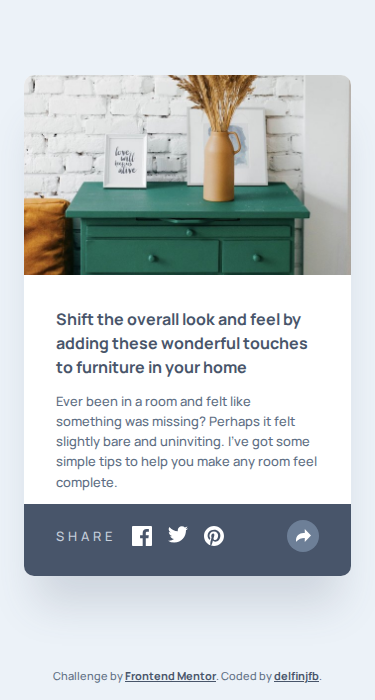

# Frontend Mentor - Article preview component solution

This is a solution to the [Article preview component challenge on Frontend Mentor](https://www.frontendmentor.io/challenges/article-preview-component-dYBN_pYFT), the first project of the JavaScript fundamentals learning path.

## Table of contents

- [Overview](#overview)
  - [The challenge](#the-challenge)
  - [Screenshots](#screenshots)
  - [Links](#links)
- [My process](#my-process)
  - [Built with](#built-with)
  - [What I learned](#what-i-learned)
  - [Quality checks](#quality-checks)
  - [Continued development](#continued-development)
  - [Useful resources](#useful-resources)
  - [AI collaboration](#ai-collaboration)
- [Author](#author)

## Overview

### The challenge

Users should be able to:

- View the optimal layout for the component depending on their device's screen size
- See the social media share links when they click the share icon
- See hover states for all interactive elements on the page

### Screenshots

| | Share closed | Share open |
|---|---|---|
| Desktop (1440px) |  |  |
| Mobile (375px) |  |  |

### Links

- Solution URL: [github.com/delfinjfb/javascript-article-preview-component](https://github.com/delfinjfb/javascript-article-preview-component)
- Live Site URL: _to be added once deployed_

## My process

### Built with

- Semantic HTML5 (`main`, `article`, one `h1`, `time`, a real `button` and a list of links)
- CSS custom properties, Flexbox, one `min-width` breakpoint (mobile first)
- Vanilla JavaScript (no framework, as the learning path asks)
- [Manrope](https://fonts.google.com/specimen/Manrope) from Google Fonts

### What I learned

**The share menu is one element with two layouts.** On mobile it is a bar that covers the card
footer; on desktop it is a tooltip above the button. Making `.share` `position: static` on mobile
(so the bar anchors to the card) and `position: relative` from the breakpoint up (so the tooltip
anchors to the button) avoided duplicating the markup.

**A problem I hit: the share icon was blank.** I first drew the icon with a CSS `mask-image` so
its colour could change on hover. Opened straight from disk (`file://`), the browser refused the
mask (masks need CORS), so the button looked empty, while the rest of the page was fine. I only
noticed because I screenshotted the open state. Fix: inline the SVG with `fill="currentColor"`,
which needs no request and changes colour with the button's `color`.

**Button state lives in the DOM, not in a variable.** The toggle reads and writes
`aria-expanded`, so the visual state, the screen-reader state and the code cannot disagree:

```js
function setShareOpen(isOpen) {
  shareToggle.setAttribute('aria-expanded', String(isOpen));
  shareMenu.hidden = !isOpen;
}
```

### Quality checks

- **No horizontal scroll** at 320, 375, 599, 600, 720 and 1440px (`document.documentElement.scrollWidth`).
- **Contrast measured with the WCAG formula, not by eye.** Three style-guide colours fail AA
  (4.5:1) for small text on their backgrounds: body text 4.08:1, the date 2.25:1 and the SHARE
  label 3.34:1. I kept the hues and shifted lightness, giving 5.23:1, 4.83:1 and 4.83:1. This is
  a deliberate, small deviation from the style guide.
- **Keyboard:** the button is focusable, shows a visible focus ring, and Escape closes the menu
  and returns focus to it.
- **Reduced motion:** the open animation and transitions are disabled with `prefers-reduced-motion`.
- Not checked: real devices, Safari and Firefox (only Chromium was tested), and a screen reader.

### Continued development

- Build the share links from the page URL and title once the page has a live address (they
  currently open each network's home page).
- Test the menu with a real screen reader and in Firefox and Safari.
- Try a `<dialog>`/popover-based version and compare it with this hand-rolled toggle.

### Useful resources

- [MDN: `aria-expanded`](https://developer.mozilla.org/en-US/docs/Web/Accessibility/ARIA/Reference/Attributes/aria-expanded) - the state the toggle button exposes.
- [WCAG contrast (minimum)](https://www.w3.org/WAI/WCAG22/Understanding/contrast-minimum.html) - the 4.5:1 rule and its formula.

### AI collaboration

I used Claude Code to build this solution and to run the checks above (screenshots at several
widths, the contrast calculation). I set the brief and reviewed the result. What worked: comparing
real screenshots against the design JPGs caught the blank icon and a clipped tooltip that reading
the code did not. What needed my judgement: the starter's AI instructions ask for hints only, and I
chose to have the assistant write the code, so treat this as an assisted solution.

## Author

- GitHub - [@delfinjfb](https://github.com/delfinjfb)
